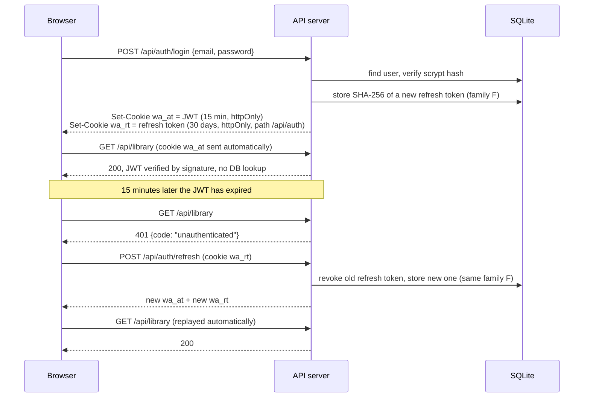

# WikiAsterisk

A calm, modern reader for Wikipedia and its sister wikis. Search any article in any language, read it in a focused Medium-style layout, watch its videos, highlight passages, and keep a library that syncs across devices when you sign in.

## Features

**Reading**
- Clean article layout: serif body text, sans-serif headings, reading time, last-edited date, and a progress bar.
- Floating table of contents on wide screens; a contents sheet on phones.
- Footnote popovers with links to the original sources, plus a searchable references panel.
- Hover previews for linked articles (mouse only). Links open inside the app, not on Wikipedia.
- "At a glance" facts from the infobox, "Keep reading" recommendations, further-reading links.
- Listen: the browser reads the article aloud from the section you're on.
- Download any article as Markdown (with attribution).
- Keyboard shortcuts: `/` search, `j`/`k` sections, `s` save, `n` notes, `m` media, `r` references, `p` listen, `?` help.

**Video, images and audio**
- Videos and audio clips play inline. Every image, video and clip in an article is collected into a media gallery with filters.
- Full-screen lightbox with keyboard and swipe navigation and "show in article".
- Images are served from Wikimedia's thumbnail CDN at sizes that suit the screen.

**Any wiki, any language**
- Wikipedia in every language, plus Wiktionary, Wikivoyage, Wikibooks, Wikiquote, Wikinews, Wikiversity and Wikisource.
- Right-to-left languages (Urdu, Arabic, Persian, Hebrew…) are laid out correctly.
- "Read in another language" for every article that has translations.
- Paste any Wikimedia link (desktop or mobile) and it opens in the reader.

**Discovery**
- Home page with today's featured article, trending articles with view sparklines, the picture of the day, news, and "on this day".
- Instant search (`Ctrl/⌘ K`) with suggestions, full-text search with excerpts, and "Surprise me".

**Any article link**
- Paste any article link (a blog post, newsletter, news story) into search and it opens in the same reader: clean typography, sections, images and video, highlights, saving and AI help.
- Pages are extracted with Mozilla Readability; sites that block bots fall back to Exa's copy of the page.
- Links are fetched safely: private and internal network addresses are refused, every redirect is re-checked, and pages are size- and time-limited.

**Ask AI**
- A side panel (a bottom sheet on phones) that answers questions about the article you're reading, or anything at all, without leaving the page.
- Answers stream in with numbered citations; source cards link to the article and to live web results from Exa.
- Auto mode uses Claude Haiku 5.5 for quick questions and GPT-6 Luna with high reasoning for "why / compare / analyze" questions; you can also pick Fast or Deep. Deep answers show a live summary of what the model is thinking about.
- Web search runs automatically when no article is open or when you ask about recent events; it can also be forced on or off.
- Select any passage and press Ask to have it explained in context. Type a question into search and Ask AI is offered first. Shortcut: `A`.

**Your library**
- Highlights in four colors with notes, repainted on the text whenever you return.
- Saved articles and reading history with "continue where you left off".
- Works without an account (stored in the browser). Sign in to sync. Anything saved as a guest moves into the account.

## Getting started

Requires **Node.js 22.13 or newer** (the server uses Node's built-in SQLite).

```bash
npm install
```

```bash
npm run dev
```

The app runs at http://localhost:5173 and the API at http://localhost:3001 (Vite proxies `/api`). No configuration is needed for development; see `.env.example` for options.

```bash
npm test
```

```bash
npm run typecheck
```

```bash
npm run lint
```

## Production

```bash
npm run build
```

```bash
npm start
```

`npm start` serves the built client and the API from one process on `PORT`. Set `JWT_SECRET` (the server refuses to start without it) and keep the `data/` directory on persistent storage. The server sends a Content-Security-Policy, long-lived caching for hashed assets, and pre-compressed (Brotli/gzip) API responses.

## Fonts

The interface uses **Noe Text** and **Noe Standard** (Schick Toikka) and **Atlas Grotesk** (Commercial Type), loaded from `public/FONTT`. These are commercial typefaces; make sure a web licence covers the domain you deploy to. If the files are missing, the app falls back to the open-source **Newsreader** and **Geist**, which also cover scripts the commercial fonts don't (Greek, Cyrillic, Vietnamese).

## AI setup

AI answers are optional. Add keys to `.env` (see `.env.example`) and restart the server:

- `OPENROUTER_API_KEY` enables answers. Set a spending limit on the key in the OpenRouter dashboard.
- `EXA_API_KEY` enables live web search, "Keep reading" for web pages, and reading pages that block direct fetching.
- `AI_QUICK_MODEL` and `AI_DEEP_MODEL` choose the models (defaults: `anthropic/claude-haiku-5.5` and `openai/gpt-6-luna`).

Keys stay on the server; the browser only talks to `/api/ai`. Guests can ask 20 questions per 10 minutes and signed-in readers 60, so a public deployment can't run up the bill. Article text and web results are passed to the model as sources to quote, with an instruction to ignore any instructions inside them, and answers are rendered as plain Markdown (never raw HTML).

## How sign-in works (JWT)



- **Access token**: a JWT (HS256, signed with `JWT_SECRET`) holding the user id and name, valid for 15 minutes. The server checks it on every request without touching the database.
- **Refresh token**: 256 random bits, stored only as a SHA-256 hash, valid for 30 days. It is rotated on every use. If an already-used token shows up again (outside a 10-second grace window for tabs refreshing at the same time), the server treats it as stolen and revokes every token from that sign-in.
- **Storage**: both tokens live in `httpOnly` cookies, so JavaScript, and therefore any injected script, can never read them. A third cookie, `wa_s=1`, carries no secret and only tells the app a session exists, so guests skip a pointless session check.
- **CSRF**: cookies are `SameSite`, and every state-changing request must carry an `x-wa-request` header. Other sites can't add that header without a CORS preflight, which this server never grants.
- **Passwords**: hashed with scrypt (Node's built-in crypto) with a per-user salt. Login is rate-limited and takes the same time whether or not the email exists.
- **Sign out** revokes that sign-in's refresh tokens. **Sign out everywhere** revokes all of them. **Delete account** removes the user and all their data.
- **Sessions in the client**: `src/lib/api.ts` retries a request once after a 401 and shares a single refresh call between concurrent requests.

## API

All routes are under `/api`. Writes require the header `x-wa-request: 1`.

| Method | Path | Notes |
| --- | --- | --- |
| GET | `/wiki/article?wiki=en&title=Moon` or `?url=<wiki link>` | Parsed article: sections, media, footnotes, infobox, languages |
| GET | `/wiki/summary?wiki=en&title=Moon` | Short summary (link previews) |
| GET | `/wiki/search?wiki=en&q=moon[&mode=full]` | Title suggestions, or full-text results |
| GET | `/wiki/related?wiki=en&title=Moon` | "More like this" |
| GET | `/wiki/feed?wiki=en` | Today's featured content (Wikipedia only) |
| GET | `/wiki/random?wiki=en` | A random article summary |
| POST | `/auth/register`, `/auth/login`, `/auth/refresh`, `/auth/logout`, `/auth/logout-all` | Session management |
| GET / PATCH / DELETE | `/auth/me` | Current user, rename, delete account |
| GET | `/library` | Bookmarks, highlights and history |
| PUT / DELETE | `/library/bookmarks` | Save / remove an article |
| PUT / DELETE | `/library/history` | Record progress / clear history |
| POST / PATCH / DELETE | `/library/highlights[/:id]` | Highlights and notes |
| POST | `/library/import` | Merge a guest library after sign-in |
| GET | `/web/article?url=<link>` | Any article page, extracted into the reader format |
| GET | `/web/similar?url=<link>` | Similar pages (Exa) |
| GET | `/ai/status` | Whether AI answers and web search are configured |
| POST | `/ai/ask` | Streams an answer as newline-delimited JSON (`meta`, `status`, `sources`, `reasoning`, `delta`, `done`) |

`wiki` accepts `en`, `de.wikivoyage`, `ur.wikipedia.org` and similar.

## Project structure

```text
shared/            Types and wiki URL helpers used by both server and client
server/
  index.ts         Starts the HTTP server
  app.ts           Express app: security headers, API routes, static hosting in production
  config.ts        Environment configuration
  db.ts            SQLite (node:sqlite) and migrations
  http.ts          Errors, rate limiting, CSRF check, LRU cache
  auth/            Password hashing, JWT and refresh tokens, auth routes
  library.ts       Bookmarks, highlights, history
  wiki/            Wikimedia API client, HTML parser/sanitizer, wiki routes
  web/             Safe page fetcher (SSRF guard), reader-mode extraction, web routes
  ai/              OpenRouter streaming, Exa search, article context, the /ai routes
src/
  routes/          TanStack Router file routes
  components/      Pages and UI (reader/ holds the article reader)
  lib/             API client, session, library sync, search, text anchoring
tests/             node:test suites (parser, URL helpers, web extraction and link safety, AI routing, auth and library API)
```

## Attribution

Article text and media come from Wikimedia projects and their contributors, under [CC BY-SA 4.0](https://creativecommons.org/licenses/by-sa/4.0/) or the license stated on each file page. The reader links back to every source article and file. WikiAsterisk is independent and not affiliated with the Wikimedia Foundation.
